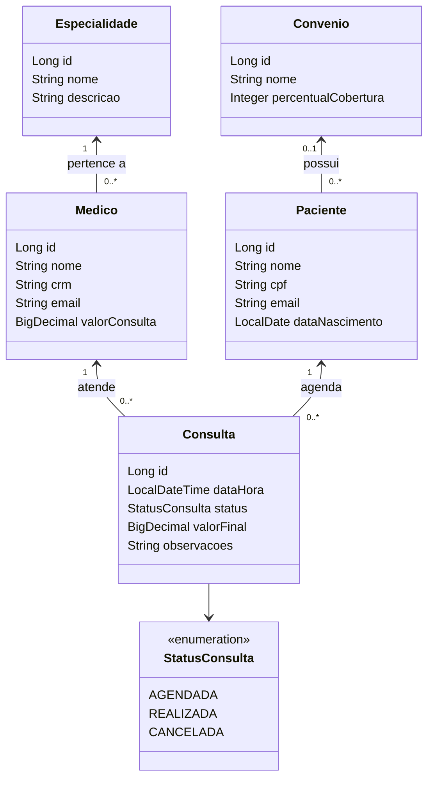

# Diagrama de classes — Medicare

O GitHub desenha este diagrama automaticamente (Mermaid).

## Tabelas geradas (MySQL)

| Tabela | Chaves estrangeiras |
|---|---|
| especialidades | — |
| convenios | — |
| medicos | especialidade_id → especialidades.id |
| pacientes | convenio_id → convenios.id (opcional) |
| consultas | medico_id → medicos.id, paciente_id → pacientes.id |
